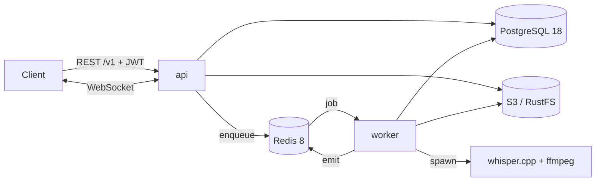

# MeetNote

Ứng dụng biên bản họp theo nhóm. Người dùng thuộc tổ chức, tổ chức có các kênh, thành viên chia sẻ cuộc họp vào kênh. File ghi âm được chuyển thành transcript có timestamp (Whisper chạy local) và tóm tắt bằng AI. Mỗi sáng thứ 2, hệ thống tổng hợp báo cáo tuần cho từng kênh.

> Project cá nhân để **học sâu** NestJS + PostgreSQL. Ưu tiên làm đúng, có test với DB thật, hiểu vì sao. Không ưu tiên ra tính năng nhanh.

## Tính năng (theo lộ trình)

| Khối                | Nội dung                                                                                                              | Mốc     |
| ------------------- | --------------------------------------------------------------------------------------------------------------------- | ------- |
| Tài khoản & tổ chức | JWT access + refresh rotation, vai trò Owner/Admin/Member, link mời có hạn, duyệt yêu cầu, chuyển sở hữu              | M1–M3   |
| Kênh                | Công khai/riêng tư, vai trò Owner/Admin/Member/Guest, chuyển chủ kênh, lưu trữ, tìm thành viên không dấu              | M4      |
| Cuộc họp            | Upload chunked resume được, worker Whisper → transcript, tóm tắt AI, tiến độ realtime, full-text search, xuất SRT/VTT | M5–M8   |
| Báo cáo tuần        | Cron 08:00 thứ 2 (giờ VN), retry khi AI lỗi, tạo lại tối đa 3 lần                                                     | M9      |
| Thông báo & audit   | Thông báo realtime, đã đọc, xoá mềm. Audit log thao tác quản trị                                                      | M3, M10 |

Trạng thái hiện tại: **M0 (khung dự án)**. Chi tiết trong [docs/plans/](docs/plans/).

## Stack

| Thành phần      | Phiên bản                                                |
| --------------- | -------------------------------------------------------- |
| Node.js         | 24 LTS                                                   |
| NestJS          | 12 (ESM, TypeScript 6 strict)                            |
| PostgreSQL      | 18 (`uuidv7`, `unaccent`, `pg_trgm`, tsvector)           |
| Redis           | 8                                                        |
| ORM             | Drizzle 0.45                                             |
| Queue           | BullMQ 6 (worker là tiến trình riêng)                    |
| Log             | pino (nestjs-pino) + `x-request-id`                      |
| Tài liệu API    | `@nestjs/swagger` + CLI plugin → `/docs`, `openapi.json` |
| Test            | Vitest 5 + Testcontainers (Postgres/Redis thật)          |
| Lint/format     | oxlint (type-aware) + Prettier                           |
| Object storage  | S3 API (RustFS khi chạy local)                           |
| Package manager | pnpm 12                                                  |

Bảng phiên bản chi tiết và lưu ý tương thích: [docs/design/09-versions.md](docs/design/09-versions.md).

## Kiến trúc



- `api` (`src/main.ts`) và `worker` (`src/worker.ts`) chung một codebase và một Docker image.
- api → worker chỉ đi qua queue. worker → client đi qua Redis.

Chi tiết: [docs/design/02-architecture.md](docs/design/02-architecture.md).

## Bắt đầu

### Yêu cầu

- Node.js 24 (`.nvmrc`)
- pnpm 12: `corepack enable` (Node 24) hoặc `npm i -g pnpm@12`
- Docker (Docker Desktop / OrbStack / Colima): cần cho e2e test và Compose
  - Testcontainers không đọc docker context. Nếu không có `/var/run/docker.sock` (vd OrbStack cài không có quyền admin), tạo `~/.testcontainers.properties` với dòng `docker.host=unix:///Users/<you>/.orbstack/run/docker.sock`

### Chạy local

```bash
pnpm install
cp .env.example .env

docker compose up -d postgres redis rustfs   # hạ tầng

pnpm build && pnpm db:migrate   # chạy migration
pnpm start:dev                  # api    → http://localhost:3000/docs
pnpm start:worker               # worker (terminal khác)
```

Hoặc chạy toàn bộ trong Docker: `docker compose up --build`.

### Lệnh thường dùng

| Lệnh                                           | Việc                                                               |
| ---------------------------------------------- | ------------------------------------------------------------------ |
| `pnpm start:dev` / `pnpm start:worker`         | Chạy api / worker ở chế độ watch                                   |
| `pnpm test`                                    | Unit test (không cần Docker)                                       |
| `pnpm test:e2e`                                | Integration + e2e với Postgres/Redis thật (Testcontainers)         |
| `pnpm lint` / `pnpm typecheck` / `pnpm format` | oxlint / tsc / Prettier                                            |
| `pnpm db:generate --name=xxx`                  | Sinh migration từ schema Drizzle. **Đọc lại SQL trước khi commit** |
| `pnpm db:generate --custom --name=xxx`         | Tạo migration SQL rỗng để viết tay                                 |
| `pnpm build && pnpm openapi:export`            | Xuất `openapi.json` (CI kiểm tra file này khớp code)               |

### Đường dẫn

| URL                                     |                                                           |
| --------------------------------------- | --------------------------------------------------------- |
| `GET /health/live`, `GET /health/ready` | Liveness / readiness (DB + Redis)                         |
| `/docs`, `/docs-json`                   | Swagger UI / OpenAPI JSON (tắt khi `NODE_ENV=production`) |
| `/v1/...`                               | API nghiệp vụ                                             |

## Cấu trúc thư mục

```
src/
  main.ts, worker.ts          entry của 2 tiến trình
  core.module.ts              hạ tầng dùng chung (config, log, db, redis, queue)
  bootstrap/                  cấu hình app + Swagger (dùng chung với e2e)
  common/                     lỗi, phân trang cursor, decorator Swagger
  infra/                      database (Drizzle), redis, queue, logger
  modules/<domain>/           controller → service → repository + policy
  scripts/                    migrate, export-openapi
migrations/                   SQL migration (commit)
test/                         e2e + Testcontainers setup
docs/design/                  thiết kế (DB, quyền, API, luồng, quy ước…)
docs/plans/                   plan từng mốc (viết trước khi code)
.claude/                      skill + cấu hình plugin cho Claude Code
```

## Tài liệu

Bắt đầu từ [docs/README.md](docs/README.md):

- [Tổng quan & quyết định](docs/design/01-overview.md)
- [Database](docs/design/03-database.md)
- [Phân quyền](docs/design/04-authorization.md)
- [API](docs/design/05-api.md)
- [Luồng xử lý](docs/design/06-flows.md)
- [Quy ước](docs/design/07-conventions.md)
- [Test](docs/design/08-testing.md)
- [Lộ trình](docs/design/10-roadmap.md)

## Làm việc với Claude Code

Repo có sẵn cấu hình để Claude Code làm việc đúng quy ước. Hướng dẫn chính nằm ở [CLAUDE.md](CLAUDE.md).

**Skill riêng của dự án** ([.claude/skills/](.claude/skills/)) được commit cùng code, clone về là có:

| Skill                | Dùng khi                                            |
| -------------------- | --------------------------------------------------- |
| `milestone-workflow` | Bắt đầu / đóng một mốc, viết plan vào `docs/plans/` |
| `nest-endpoint`      | Thêm endpoint, DTO, module                          |
| `drizzle-schema`     | Đổi schema, viết migration                          |
| `db-transactions`    | Transaction, khoá dòng, idempotency                 |
| `authorization`      | Guard, policy, ma trận quyền                        |
| `bullmq-jobs`        | Queue, worker, cron                                 |
| `testing`            | Unit / integration / e2e test                       |
| `add-dependency`     | Thêm / nâng cấp thư viện                            |

**Plugin** khai báo trong [.claude/settings.json](.claude/settings.json), từ marketplace `claude-plugins-official`:

- `superpowers`, `feature-dev`, `code-review`, `commit-commands`
- `skill-creator`, `typescript-lsp`, `context7`, `supabase`

Khi mở repo và trust thư mục, Claude Code sẽ gợi ý cài các plugin này. Cài thủ công thì dùng `/plugin`. Bảng giải thích từng plugin nằm ở [CLAUDE.md](CLAUDE.md#skills).
