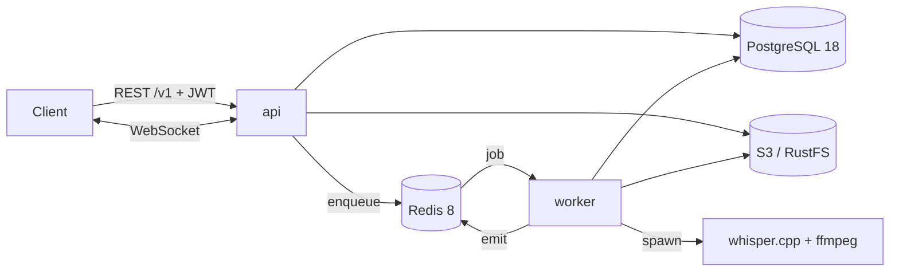

# MeetNote

Ứng dụng biên bản họp theo nhóm. Người dùng thuộc tổ chức, tổ chức có các kênh, thành viên chia sẻ cuộc họp vào kênh. File ghi âm được chuyển thành transcript có timestamp (Whisper chạy local) và tóm tắt bằng AI. Mỗi sáng thứ 2, hệ thống tổng hợp báo cáo tuần cho từng kênh.

> Project cá nhân để **học sâu** NestJS + PostgreSQL. Ưu tiên làm đúng, có test với DB thật, hiểu vì sao. Không ưu tiên ra tính năng nhanh.

## Tính năng (theo lộ trình)

| Khối                | Nội dung                                                                                                              | Mốc     |
| ------------------- | --------------------------------------------------------------------------------------------------------------------- | ------- |
| Tài khoản & tổ chức | JWT access + refresh rotation, vai trò Owner/Admin/Member, link mời có hạn, duyệt yêu cầu, chuyển sở hữu              | M1–M3   |
| Kênh                | Công khai/riêng tư, vai trò Owner/Admin/Member/Guest, chuyển chủ kênh, lưu trữ, tìm thành viên không dấu              | M4      |
| Cuộc họp            | Upload chunked resume được, worker Whisper → transcript, tóm tắt AI, tiến độ realtime, full-text search, xuất SRT/VTT | M5–M8   |
| Báo cáo tuần        | Cron 08:00 thứ 2 (giờ VN), retry khi AI lỗi, tạo lại tối đa 3 lần                                                     | M9      |
| Thông báo & audit   | Thông báo realtime, đã đọc, xoá mềm. Audit log thao tác quản trị                                                      | M3, M10 |

Trạng thái hiện tại:

| Mốc                            | Trạng thái                                                                                                                                                                              |
| ------------------------------ | --------------------------------------------------------------------------------------------------------------------------------------------------------------------------------------- |
| M0 — Khung                     | Xong                                                                                                                                                                                    |
| M1 — Auth                      | Xong (PR #1)                                                                                                                                                                            |
| M2 — Tổ chức                   | Xong (PR #2)                                                                                                                                                                            |
| M3 — Mời, duyệt, sở hữu, audit | Xong (PR #3)                                                                                                                                                                            |
| M4 — Kênh                      | Đang làm: schema, policy, CRUD kênh, thành viên kênh, tham gia / rời / chuyển chủ kênh, lưu trữ, xoá mềm + logic dọn dẹp xong; tiếp theo chặn rời org khi còn làm chủ kênh, xoá tổ chức |

Chi tiết từng mốc (các bước, quyết định, bài học) trong [docs/plans/](docs/plans/).

## Stack

| Thành phần      | Phiên bản                                                |
| --------------- | -------------------------------------------------------- |
| Node.js         | 24 LTS                                                   |
| NestJS          | 12 (ESM, TypeScript 6 strict)                            |
| PostgreSQL      | 18 (`uuidv7`, `unaccent`, `pg_trgm`, tsvector)           |
| Redis           | 8                                                        |
| ORM             | Drizzle 0.45                                             |
| Queue           | BullMQ 6 (worker là tiến trình riêng)                    |
| Log             | pino (nestjs-pino) + `x-request-id`                      |
| Tài liệu API    | `@nestjs/swagger` + CLI plugin → `/docs`, `openapi.json` |
| Test            | Vitest 5 + Testcontainers (Postgres/Redis thật)          |
| Lint/format     | oxlint (type-aware) + Prettier                           |
| Object storage  | S3 API (RustFS khi chạy local)                           |
| Package manager | pnpm 12                                                  |

Bảng phiên bản chi tiết và lưu ý tương thích: [docs/design/09-versions.md](docs/design/09-versions.md).

## Kiến trúc



- `api` (`src/main.ts`) và `worker` (`src/worker.ts`) chung một codebase và một Docker image.
- api → worker chỉ đi qua queue. worker → client đi qua Redis.

Chi tiết: [docs/design/02-architecture.md](docs/design/02-architecture.md).

## Bắt đầu

### Yêu cầu

- Node.js 24 (`.nvmrc`)
- pnpm 12: `corepack enable` (Node 24) hoặc `npm i -g pnpm@12`
- Docker (Docker Desktop / OrbStack / Colima): cần cho e2e test và Compose
  - Testcontainers không đọc docker context. Nếu không có `/var/run/docker.sock` (vd OrbStack cài không có quyền admin), tạo `~/.testcontainers.properties` với dòng `docker.host=unix:///Users/<you>/.orbstack/run/docker.sock`

### Chạy local

```bash
pnpm install
cp .env.example .env

docker compose up -d postgres redis rustfs   # hạ tầng

pnpm build && pnpm db:migrate   # chạy migration
pnpm start:dev                  # api    → http://localhost:3000/docs
pnpm start:worker               # worker (terminal khác)
```

Hoặc chạy toàn bộ trong Docker: `docker compose up --build`.

### Lệnh thường dùng

| Lệnh                                           | Việc                                                               |
| ---------------------------------------------- | ------------------------------------------------------------------ |
| `pnpm start:dev` / `pnpm start:worker`         | Chạy api / worker ở chế độ watch                                   |
| `pnpm test`                                    | Unit test (không cần Docker)                                       |
| `pnpm test:e2e`                                | Integration + e2e với Postgres/Redis thật (Testcontainers)         |
| `pnpm lint` / `pnpm typecheck` / `pnpm format` | oxlint / tsc / Prettier                                            |
| `pnpm db:generate --name=xxx`                  | Sinh migration từ schema Drizzle. **Đọc lại SQL trước khi commit** |
| `pnpm db:generate --custom --name=xxx`         | Tạo migration SQL rỗng để viết tay                                 |
| `pnpm build && pnpm openapi:export`            | Xuất `openapi.json` (CI kiểm tra file này khớp code)               |

### Đường dẫn

| URL                                     |                                                           |
| --------------------------------------- | --------------------------------------------------------- |
| `GET /health/live`, `GET /health/ready` | Liveness / readiness (DB + Redis)                         |
| `/docs`, `/docs-json`                   | Swagger UI / OpenAPI JSON (tắt khi `NODE_ENV=production`) |
| `/v1/...`                               | API nghiệp vụ                                             |

## Cấu trúc thư mục

```
src/
├─ main.ts, worker.ts          entry của 2 tiến trình (api, worker)
├─ app.module.ts               module gốc của api
├─ worker.module.ts            module gốc của worker (chỉ processor, không HTTP)
├─ core.module.ts              hạ tầng dùng chung (config, log, db, redis, queue)
├─ bootstrap/                  cấu hình app + Swagger (dùng chung với e2e)
├─ config/                     validate biến môi trường
├─ common/                     dùng chung mọi module
│  ├─ errors/                  catalog lỗi `Errors`, AppException, ErrorCode, exception filter
│  ├─ pagination/              cursor, khoá keyset, CursorQueryDto
│  ├─ auth/                    @Public, @CurrentUser, kiểu AuthUser
│  ├─ swagger/                 @ApiErrorResponses, @ApiPaginatedResponse
│  └─ crypto/, validation/     token opaque, kiểm tra uuid
├─ infra/                      database (Drizzle + schema), redis, queue, logger
├─ modules/<domain>/           auth, me, users, organizations, invites, channels, audit, health
└─ scripts/                    migrate, export-openapi
migrations/                    SQL migration (drizzle-kit + viết tay), đã commit thì không sửa
test/
├─ unit/                       không cần Docker; mô phỏng cây src/ + `architecture/` (test quy ước)
├─ integration/                Postgres/Redis thật: schema, race test, service
├─ e2e/                        gọi HTTP thật qua toàn bộ app
└─ support/                    Testcontainers setup, factory, helper khoá (`runWhileLocked`)
docs/design/                   thiết kế (DB, quyền, API, luồng, quy ước…)
docs/plans/                    plan từng mốc (viết trước khi code)
```

### Bên trong một module

Ví dụ `src/modules/channels/`:

```
channels/
├─ channels.module.ts
├─ channel.policy.ts          policy thuần: (người gọi, kênh) → quyết định
├─ channel-decisions.ts       quyết định của policy → lỗi (Errors.*)
├─ channels.types.ts          interface / type viết tay của module
├─ controllers/               chỉ HTTP: route, DTO, Swagger — không có logic
├─ services/                  use-case: transaction, khoá dòng, gọi policy, ghi audit
├─ repositories/              query Drizzle, nhận `tx` của service
├─ guards/                    guard + decorator gộp guard (@RequireChannelPermission)
└─ dto/                       *.dto.ts (request + response), Swagger plugin đọc
```

Luồng: controller → service → repository. Policy là hàm thuần, guard và service cùng gọi.

**Quy tắc thư mục theo vai trò:** trong một thư mục, khi có **từ 2 file cùng vai trò** trở lên (`*.service.ts`, `*.repository.ts`, `*.controller.ts`, `*.types.ts`) thì gom vào `services/`, `repositories/`, `controllers/`, `types/`. Chỉ có 1 file thì để ngay cấp module (vd `me/me.service.ts`). `dto/` và `guards/` luôn là thư mục; `*.module.ts` luôn ở cấp module. Cây `test/` dời theo cho test gắn với một file cụ thể (vd `test/unit/modules/auth/services/token.service.spec.ts`); test theo kịch bản race để ở cấp module.

## Quy ước code

Đầy đủ trong [docs/design/07-conventions.md](docs/design/07-conventions.md). Những điều quan trọng nhất:

| Chủ đề               | Quy ước                                                                                                                                                                                                                                                                                                                |
| -------------------- | ---------------------------------------------------------------------------------------------------------------------------------------------------------------------------------------------------------------------------------------------------------------------------------------------------------------------- |
| ESM                  | Import tương đối phải có đuôi `.js`. Dùng `import.meta.dirname`, không dùng `__dirname`.                                                                                                                                                                                                                               |
| Dependency injection | Class inject qua constructor phải import **giá trị**, không `import type`. Token Symbol (`DRIZZLE`) đi kèm `@Inject()`.                                                                                                                                                                                                |
| Lỗi                  | Mọi lỗi trả về client lấy từ catalog [`src/common/errors/errors.ts`](src/common/errors/errors.ts): `throw Errors.channel.archived()`. Lỗi mới thì thêm mục vào catalog. Không tự `new AppException(...)`. Client dựa vào `code`, `message` cho người đọc. Tài nguyên người gọi không được thấy trả **404**, không 403. |
| Interface / type     | Kiểu viết tay được export nằm trong `<module>.types.ts`, kể cả `declare global` mở rộng `Express.Request`. Kiểu suy ra từ giá trị (`typeof`, `$inferSelect`, cặp const/type cùng tên như `OrgRole`) để cạnh giá trị gốc. File types không chứa giá trị runtime.                                                        |
| DTO                  | `class` trong `*.dto.ts`, mô tả bằng JSDoc (Swagger CLI plugin đọc). Không trả row DB, luôn map sang `*ResponseDto`. Method controller khai báo kiểu trả về. Query param có giá trị mặc định thì thêm `@ApiPropertyOptional()`.                                                                                        |
| Response             | Thành công: `{ data, meta: { statusCode, requestId } }` (danh sách thêm `meta.nextCursor`). Lỗi: `{ error: { code, statusCode, message, details?, requestId } }`. `204` không body; `/health/*` trả body thô. Controller / service không tự bọc: interceptor toàn cục bọc, Swagger bọc tương ứng.                      |
| Danh sách            | Phân trang cursor (`meta.nextCursor`) theo keyset, có index khớp đúng thứ tự sort. Timestamp trong cursor lấy dạng text từ DB (đủ micro giây). Cursor bị sửa tay → 400 `INVALID_CURSOR`, không 500.                                                                                                                    |
| Phân quyền           | `JwtAuthGuard` (global) → `OrgMemberGuard` (404) → `ChannelAccessGuard` (404) → guard quyền (403), gộp sẵn trong `@RequireOrgPermission` / `@RequireChannelPermission`. Ma trận quyền: [04-authorization.md](docs/design/04-authorization.md).                                                                         |
| Transaction          | Đổi quyền / sở hữu: khoá dòng cha trước, **kiểm tra lại sau khi khoá**, audit trong cùng transaction, enqueue / publish sau commit. Thứ tự khoá chung: `organization_members` → `channels` → `channel_members` (tránh deadlock).                                                                                       |
| Schema               | Đặt tên mọi constraint. Enum = `text` + `CHECK`. Bảng con có composite FK theo `org_id`. Không sửa migration đã commit.                                                                                                                                                                                                |
| BullMQ               | Payload chỉ chứa ID. `jobId = <tên-job>.<id>[.<lần>]`, không có `:`. Processor idempotent.                                                                                                                                                                                                                             |
| Git                  | Conventional Commits, mỗi mốc một nhánh `mx-<slug>`, merge qua PR.                                                                                                                                                                                                                                                     |

## Test

| Loại        | Ở đâu                     | Chạy            | Ghi chú                                                                                                                                         |
| ----------- | ------------------------- | --------------- | ----------------------------------------------------------------------------------------------------------------------------------------------- |
| Unit        | `test/unit/`              | `pnpm test`     | Hàm thuần, policy (bảng phủ toàn bộ ma trận quyền), service với Nest TestingModule                                                              |
| Kiến trúc   | `test/unit/architecture/` | `pnpm test`     | Quét `src/` và `openapi.json` để giữ quy ước: lỗi chỉ tạo trong catalog, vị trí interface/type, thư mục theo vai trò, envelope `{ data, meta }` |
| Integration | `test/integration/`       | `pnpm test:e2e` | Postgres 18 + Redis 8 thật (Testcontainers). Ràng buộc schema, EXPLAIN index, **race test**                                                     |
| E2E         | `test/e2e/`               | `pnpm test:e2e` | HTTP thật qua toàn bộ app, phân quyền dạng bảng                                                                                                 |

- Mỗi file test có một database riêng, clone từ template đã chạy migration.
- Mỗi chỗ khoá dòng đều có race test. Thứ tự xen kẽ được ép bằng `runWhileLocked` (T1 giữ khoá, T2 phải thực sự đợi rồi mới cho T1 commit). Test được **kiểm chứng bằng đột biến**: bỏ khoá hoặc bỏ bước kiểm tra lại thì test phải đỏ. Kết quả ghi trong plan của từng mốc.

Kiểm tra trước khi đẩy code:

```bash
pnpm format:check && pnpm lint && pnpm typecheck && pnpm test
pnpm test:e2e                          # cần Docker
pnpm build && pnpm openapi:export      # openapi.json phải khớp code (CI kiểm tra)
```

## Tài liệu

Bắt đầu từ [docs/README.md](docs/README.md):

- [Tổng quan & quyết định](docs/design/01-overview.md)
- [Database](docs/design/03-database.md)
- [Phân quyền](docs/design/04-authorization.md)
- [API](docs/design/05-api.md)
- [Luồng xử lý](docs/design/06-flows.md)
- [Quy ước](docs/design/07-conventions.md)
- [Test](docs/design/08-testing.md)
- [Lộ trình](docs/design/10-roadmap.md)

## Làm việc với Claude Code

Repo có sẵn cấu hình để Claude Code làm việc đúng quy ước. Hướng dẫn chính nằm ở [CLAUDE.md](CLAUDE.md).

**Skill riêng của dự án** ([.claude/skills/](.claude/skills/)) được commit cùng code, clone về là có:

| Skill                | Dùng khi                                            |
| -------------------- | --------------------------------------------------- |
| `milestone-workflow` | Bắt đầu / đóng một mốc, viết plan vào `docs/plans/` |
| `nest-endpoint`      | Thêm endpoint, DTO, module                          |
| `drizzle-schema`     | Đổi schema, viết migration                          |
| `db-transactions`    | Transaction, khoá dòng, idempotency                 |
| `authorization`      | Guard, policy, ma trận quyền                        |
| `bullmq-jobs`        | Queue, worker, cron                                 |
| `testing`            | Unit / integration / e2e test                       |
| `add-dependency`     | Thêm / nâng cấp thư viện                            |

**Plugin** khai báo trong [.claude/settings.json](.claude/settings.json), từ marketplace `claude-plugins-official`:

- `superpowers`, `feature-dev`, `code-review`, `commit-commands`
- `skill-creator`, `typescript-lsp`, `context7`, `supabase`

Khi mở repo và trust thư mục, Claude Code sẽ gợi ý cài các plugin này. Cài thủ công thì dùng `/plugin`. Bảng giải thích từng plugin nằm ở [CLAUDE.md](CLAUDE.md#skills).
