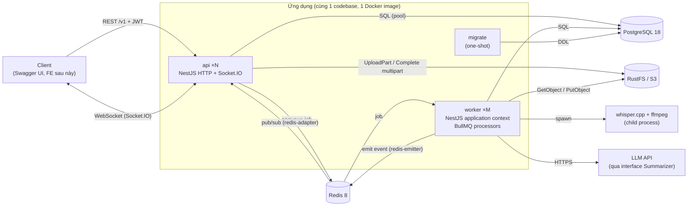

# 02 — Kiến trúc tổng thể

## 1. Các tiến trình

| Tiến trình  | Entry                    | Vai trò                                                                                                                               | Scale                                                                                   |
| ----------- | ------------------------ | ------------------------------------------------------------------------------------------------------------------------------------- | --------------------------------------------------------------------------------------- |
| **api**     | `src/main.ts`            | HTTP REST `/v1`, Swagger `/docs`, Socket.IO gateway `/realtime`. Nhận upload chunk, ghi DB, đẩy job vào queue                         | Ngang (N instance, stateless)                                                           |
| **worker**  | `src/worker.ts`          | Tiêu thụ job BullMQ: chuẩn hoá audio (ffmpeg), transcribe (whisper.cpp), tóm tắt (LLM), tạo báo cáo tuần, dọn dẹp. Không mở cổng HTTP | Theo queue: `WORKER_QUEUES=transcription` (CPU nặng, concurrency 1) tách khỏi `default` |
| **migrate** | `src/scripts/migrate.ts` | Chạy migration Drizzle **một lần** rồi thoát. api/worker chỉ khởi động sau khi migrate xong                                           | 1 lần mỗi deploy                                                                        |
| postgres    | image                    | Dữ liệu chính, full-text search                                                                                                       | 1                                                                                       |
| redis       | image                    | BullMQ, Socket.IO adapter/emitter (pub/sub), cache ngắn hạn                                                                           | 1                                                                                       |
| rustfs      | image                    | Object storage S3 (file ghi âm, audio đã chuẩn hoá)                                                                                   | 1                                                                                       |

> **Bẫy:** Không chạy migration lúc api khởi động. Khi có 2 instance, cả hai cùng migrate và đua nhau. Migration là một bước riêng trong pipeline deploy.

## 2. Sơ đồ giao tiếp



### Nguyên tắc giao tiếp

1. **api → worker chỉ đi qua queue.** api không gọi HTTP sang worker. Job mang **ID** (vd `meetingId`), không mang dữ liệu lớn. Worker tự đọc trạng thái mới nhất từ DB, vì job có thể chạy lại.
2. **worker → client đi qua Redis.** Worker dùng `@socket.io/redis-emitter` publish event vào room (`user:{id}`, `meeting:{id}`). Mọi api instance nhận qua `@socket.io/redis-adapter` rồi đẩy xuống socket tương ứng. Worker không cần biết client đang nối vào api nào.
3. **DB là nguồn sự thật, event realtime chỉ là gợi ý.** Client mất kết nối thì gọi REST để lấy lại trạng thái. Không lưu tiến độ chi tiết (từng %) vào DB, chỉ lưu các mốc `status`.
4. **Ghi DB trước, publish sau.** Event/job chỉ được phát **sau khi transaction commit**. Phát trong transaction mà transaction rollback thì client nhận event "ma". Sau này có thể nâng lên transactional outbox.

## 3. Cấu trúc thư mục

```
meetnote/
├─ src/
│  ├─ main.ts                    # entry api: HTTP + WS
│  ├─ worker.ts                  # entry worker: createApplicationContext, không HTTP
│  ├─ app.module.ts              # root module của api
│  ├─ core.module.ts             # hạ tầng dùng chung api + worker (config, log, db, redis, queue)
│  ├─ worker.module.ts           # root module của worker
│  ├─ worker/                    # thành phần riêng của worker (heartbeat…)
│  ├─ bootstrap/                 # cấu hình app dùng chung giữa main.ts và e2e test
│  │  ├─ configure-app.ts        #   versioning, pipes, filters, shutdown hooks
│  │  └─ swagger.ts              #   DocumentBuilder, /docs, /docs-json
│  ├─ config/                    # schema env (class-validator) + typed config
│  ├─ common/                    # cross-cutting, không phụ thuộc domain
│  │  ├─ errors/                 #   AppException, ErrorCode, catalog Errors, exception filter
│  │  ├─ pagination/             #   cursor codec, CursorQueryDto, PaginatedDto
│  │  ├─ swagger/                #   ApiErrorResponses, ApiPaginatedResponse
│  │  ├─ auth/                   #   (M1) @Public, @CurrentUser, guards
│  │  └─ clock/                  #   Clock interface (giả lập thời gian khi test)
│  ├─ infra/                     # adapter ra thế giới ngoài
│  │  ├─ database/               #   DrizzleModule, schema/*, transaction helper
│  │  ├─ redis/                  #   kết nối ioredis dùng chung
│  │  ├─ queue/                  #   tên queue, BullMQ config, job payload types
│  │  ├─ storage/                #   (M5) S3 client, ObjectStorage interface
│  │  ├─ realtime/               #   (M7) RealtimePublisher (redis-emitter, dùng cho cả api + worker), RedisIoAdapter, tên room
│  │  ├─ speech/                 #   (M6) SpeechToText: whisper.cpp + Fake
│  │  └─ llm/                    #   (M6) Summarizer: provider + Fake
│  ├─ modules/                   # domain modules (mỗi module 1 thư mục)
│  │  ├─ health/
│  │  ├─ auth/  users/  organizations/  channels/
│  │  ├─ uploads/  meetings/  transcripts/  reports/
│  │  ├─ notifications/  realtime/  audit/
│  └─ scripts/
│     ├─ migrate.ts              # chạy migration
│     └─ export-openapi.ts       # xuất openapi.json
├─ migrations/                   # SQL do drizzle-kit sinh + SQL viết tay (commit vào git)
├─ test/                        # MỌI test nằm ở đây, src/ chỉ chứa code ứng dụng
│  ├─ unit/                      # *.spec.ts — cây thư mục mô phỏng src/ (vd unit/modules/auth/…)
│  ├─ integration/               # *.int-spec.ts — Postgres/Redis thật, cây mô phỏng src/
│  ├─ e2e/<domain>/              # *.e2e-spec.ts — qua HTTP, gom theo domain (khớp src/modules/)
│  └─ support/                   # testcontainers global setup, factory dữ liệu, helper
├─ docker/Dockerfile             # multi-stage, 1 image cho api/worker/migrate
├─ compose.yaml
├─ docs/
└─ .github/workflows/ci.yml
```

### Bên trong một domain module (ví dụ `channels/`)

```
channels/
├─ channels.module.ts
├─ channel.policy.ts                 # hàm thuần: (actor, target) → quyết định. Dễ unit test
├─ channel-decisions.ts              # quyết định của policy → Errors.*
├─ channels.types.ts                 # interface / type viết tay của module (07 §1)
├─ controllers/                      # HTTP: route, DTO, swagger. Không chứa logic
│  ├─ channels.controller.ts
│  └─ channel-members.controller.ts
├─ services/                         # use-case: ranh giới transaction, gọi policy, ghi audit
│  ├─ channels.service.ts
│  └─ channel-members.service.ts
├─ repositories/                     # query Drizzle. Nhận `tx` để chạy trong transaction của service
│  ├─ channels.repository.ts
│  └─ channel-members.repository.ts
├─ guards/                           # guard + decorator gộp guard của domain
└─ dto/                              # *.dto.ts (request + response), Swagger plugin đọc file này

# test tương ứng: test/unit/modules/channels/…, test/integration/modules/channels/…
```

**Thư mục theo vai trò (từ M4 B4d):** trong một thư mục, khi có **từ 2 file cùng vai trò** trở lên (`*.service.ts`, `*.repository.ts`, `*.controller.ts`, `*.types.ts`) thì gom vào `services/`, `repositories/`, `controllers/`, `types/`. Chỉ có 1 file thì để ngay cấp module. `dto/` và `guards/` luôn là thư mục. `*.module.ts` luôn ở cấp module (cửa vào của thư mục). Thư mục vai trò chỉ chứa đúng vai trò đó. Test kiến trúc `test/unit/architecture/folder-layout.spec.ts` canh quy tắc này.

**Phân lớp:** controller → service → repository. Policy là các hàm thuần được service và guard gọi. Không tạo lớp "domain entity" riêng: dùng kiểu row của Drizzle bên trong, map sang response DTO ở rìa.

## 4. Danh sách module

| Module                         | Tiến trình                        | Trách nhiệm                                                                                                                                                                                  |
| ------------------------------ | --------------------------------- | -------------------------------------------------------------------------------------------------------------------------------------------------------------------------------------------- |
| `ConfigModule` (global)        | api, worker                       | Đọc + validate env khi khởi động, sai thì dừng ngay                                                                                                                                          |
| `LoggerModule` (nestjs-pino)   | api, worker                       | Log JSON, `requestId` mỗi request (`x-request-id`), redact header nhạy cảm                                                                                                                   |
| `DatabaseModule` (global)      | api, worker                       | Pool `pg`, instance Drizzle, helper `withTransaction`                                                                                                                                        |
| `RedisModule`                  | api, worker                       | Kết nối ioredis cho cache/pub-sub                                                                                                                                                            |
| `QueueModule`                  | api (producer), worker (consumer) | Kết nối BullMQ, khai báo queue, kiểu payload                                                                                                                                                 |
| `HealthModule`                 | api                               | `/health/live`, `/health/ready` (DB + Redis)                                                                                                                                                 |
| `AuthModule`                   | api                               | Đăng ký, đăng nhập, refresh rotation, logout, guard JWT global                                                                                                                               |
| `UsersModule`                  | api                               | Dữ liệu người dùng (`UsersRepository`). Không có controller, không phụ thuộc module khác                                                                                                     |
| `MeModule`                     | api                               | `/me`, `/me/sessions`. Import `UsersModule` + `AuthModule`, phụ thuộc đi một chiều users ← auth ← me                                                                                         |
| `OrganizationsModule`          | api                               | Org, thành viên, vai trò (M2); chuyển quyền sở hữu, rời org (M3). `OrgMemberGuard`, `OrgPermissionGuard`, `@RequireOrgPermission` (export để module khác dùng)                               |
| `ChannelsModule`               | api, worker (purge)               | Kênh, thành viên kênh, vai trò, chuyển chủ kênh, lưu trữ/xoá, `ChannelAccessGuard`                                                                                                           |
| `UploadsModule`                | api, worker (dọn upload hết hạn)  | Chunked upload, resume, S3 multipart                                                                                                                                                         |
| `IdempotencyModule`            | api                               | `@Idempotent()`: header `Idempotency-Key` (bảng `idempotency_keys`). Không global: module có route dùng decorator thì import                                                                 |
| `MeetingsModule`               | api, worker                       | Meeting CRUD, share vào kênh, state machine xử lý, pipeline processor                                                                                                                        |
| `TranscriptsModule`            | api, worker                       | Lưu segment, search full-text, xuất SRT/VTT                                                                                                                                                  |
| `ReportsModule`                | api, worker                       | Job scheduler cron, tạo báo cáo, tạo lại có quota, phiên bản                                                                                                                                 |
| `NotificationsCoreModule`      | api, worker                       | Ghi thông báo trong transaction (dedupe key), đẩy realtime sau commit, enqueue + chạy fan-out `notification.fanout` (M10)                                                                    |
| `NotificationsModule`          | api                               | Danh sách, đếm chưa đọc, đã đọc, xoá mềm (controller; import Core)                                                                                                                           |
| `RealtimeModule`               | api                               | Gateway Socket.IO `/realtime`: xác thực handshake (token + phiên), ngắt khi token hết hạn / phiên bị thu hồi, `subscribe` meeting theo điều kiện xem dùng chung, kiểm lại khi mất quyền (M7) |
| `RealtimeInfraModule` (global) | api, worker                       | `RealtimePublisher` (redis-emitter): phát event / ngắt socket / yêu cầu kiểm lại từ bất kỳ tiến trình nào; `RedisIoAdapter` gắn Redis adapter cho server                                     |
| `AuditModule` (global)         | api, worker                       | `AuditService.record(tx, ctx, entry)`, bắt buộc truyền `tx` của thao tác. Chỉ ghi                                                                                                            |
| `AuditLogsModule`              | api                               | `GET /orgs/:orgId/audit-logs` (đọc). Tách riêng để worker không kéo theo controller/guard                                                                                                    |
| `InvitesModule`                | api                               | Link mời (tạo/liệt kê/thu hồi/xem trước/chấp nhận), yêu cầu tham gia (duyệt/từ chối). Phụ thuộc một chiều → `OrganizationsModule`                                                            |

> **Bẫy:** Khi một module cần dùng cho cả api và worker, đừng import cả controller vào worker. Tách `XxxCoreModule` (service + repository) và `XxxHttpModule` (controller) khi cần. Worker chỉ import Core.
>
> **Một processor mỗi queue** (M10 B5): BullMQ Worker không lọc job theo tên — hai `@Processor('default')` ở hai module sẽ giành job của nhau. Processor nằm ở `src/worker/` (`DefaultQueueProcessor`), `switch (job.name)` rồi gọi service của `XxxCoreModule`; chỉ `WorkerModule` đăng ký.
